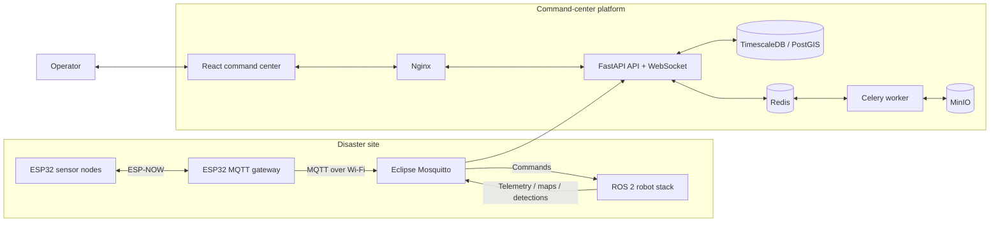
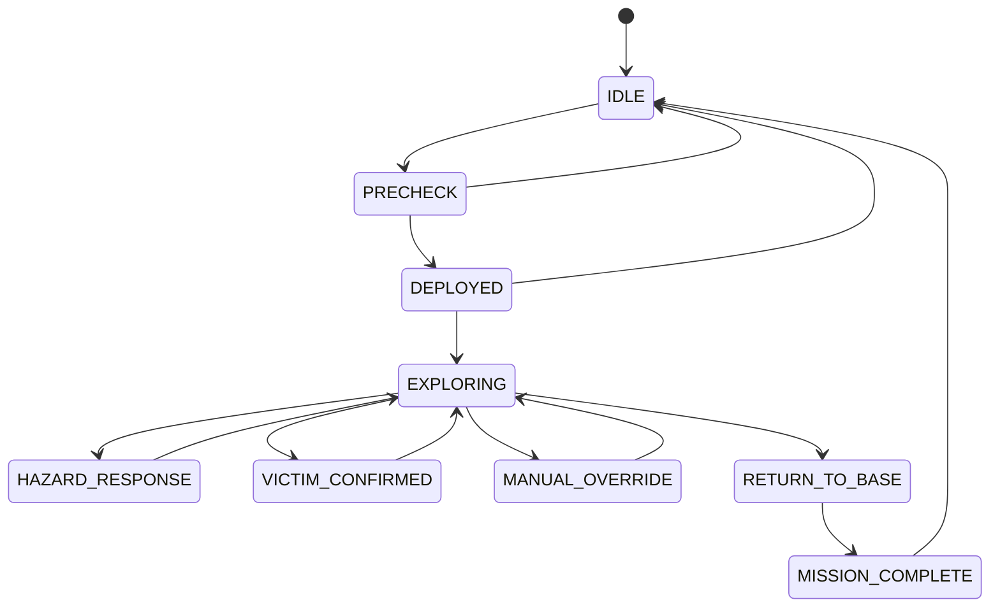

# DisasterMap

### Autonomous disaster-response mapping and command platform

[](https://react.dev/)
[](https://fastapi.tiangolo.com/)
[](https://docs.ros.org/en/humble/)
[](https://docs.docker.com/compose/)
[](LICENSE)

DisasterMap is a full-stack robotics and IoT prototype for exploring GPS-denied disaster environments. It combines a browser-based mission command center, a FastAPI control plane, MQTT telemetry, spatial/time-series storage, prototype ROS 2 robot nodes, and deployable ESP32 environmental sensors.

The repository currently provides a **functional simulation and integration prototype**. The dashboard demonstrates the complete operator workflow with simulated telemetry, while the backend, ROS 2, and firmware layers define the path toward real hardware integration.

> [!IMPORTANT]
> DisasterMap is a research and educational prototype. It has not been certified, safety-validated, or field-tested for life-critical deployment.

## Why DisasterMap?

Collapsed and hazardous indoor environments are difficult to inspect: GPS is unavailable, visibility is poor, communications can degrade, and responders may be exposed to toxic gas, fire, or unstable structures. DisasterMap explores a single operational picture in which robots and distributed sensor nodes can:

- map an unfamiliar indoor environment;
- detect possible survivors using multiple sensing modalities;
- identify and visualize environmental hazards;
- preserve communication through deployable IoT nodes;
- support autonomous exploration and operator teleoperation;
- record mission events for later analysis and reporting.

## Highlights

- **3D mission map** — voxel-style environment visualization with robot paths and mission markers.
- **Mission state machine** — controlled transitions from preflight to exploration, intervention, return, and completion.
- **Survivor-sensor fusion** — prototype Kalman-based association across thermal, acoustic, CO2, and visual detections.
- **Hazard intelligence** — gas thresholds, spatial interpolation, heatmap data, and no-go-zone commands.
- **Robot fleet view** — telemetry, health, coverage, task state, and multi-robot coordination concepts.
- **Teleoperation** — velocity, navigation-goal, emergency-stop, and robotic-arm command interfaces.
- **Deployable sensing** — ESP32-S3 node and ESP-NOW-to-MQTT gateway firmware.
- **Mission playback and analytics** — timeline, trajectory, performance, and report-generation interfaces.

## System architecture



## Technology stack

| Layer | Technology | Responsibility |
|---|---|---|
| Dashboard | React 18, Vite, Zustand, Three.js, Recharts | Operator interface and mission visualization |
| API | FastAPI, Pydantic, SQLAlchemy | Mission control, data access, commands, and WebSocket endpoints |
| Data | TimescaleDB, PostgreSQL, PostGIS | Mission, time-series, and spatial records |
| Messaging | Eclipse Mosquitto, MQTT | Robot telemetry, sensor data, and commands |
| Background work | Celery, Redis | Analytics, rosbag processing, and report jobs |
| Object storage | MinIO | Maps, recordings, reports, and mission artifacts |
| Robot | ROS 2 Humble, Nav2, RTAB-Map concepts | Mapping, navigation, perception, and hazard monitoring |
| Edge hardware | ESP32-S3, ESP-NOW, Arduino | Deployable sensor nodes and MQTT gateway |
| Deployment | Docker Compose, Nginx | Local platform orchestration and reverse proxy |

## Repository layout

```text
disaster-map/
|-- dashboard/              React command-center application
|   `-- src/
|       |-- views/          Map, fleet, victims, hazards, sensors, and more
|       |-- stores/         Zustand mission, fleet, map, and sensor state
|       |-- hooks/          Simulation and WebSocket hooks
|       `-- utils/          API client and shared constants
|-- server/                 FastAPI application and Celery workers
|   `-- app/
|       |-- api/            REST and WebSocket routes
|       |-- models/         SQLAlchemy persistence models
|       |-- schemas/        Pydantic request/response models
|       |-- services/       Fusion, mapping, planning, and coordination logic
|       |-- mqtt/           MQTT consumer, publisher, and topics
|       `-- workers/        Report, analytics, and rosbag tasks
|-- robot_ws/               ROS 2 Humble workspace
|-- firmware/               ESP32 sensor-node and gateway firmware
|-- docs/                   Architecture and hardware bill of materials
|-- mosquitto/              MQTT broker configuration
|-- nginx/                  Dashboard image and reverse-proxy configuration
|-- docker-compose.yml      Local multi-service platform
`-- .env.example            Safe configuration template
```

## Dashboard

| View | Purpose |
|---|---|
| Live Map | 3D environment, robot trail, coverage, victims, and hazards |
| Fleet | Robot health, location, battery, SLAM quality, and assignments |
| Survivors | Detection confidence, sensor modalities, evidence, and rescue status |
| Hazards | Gas readings, severity, hazard zones, and environmental trends |
| IoT Sensors | Deployed node health, readings, battery, and deployment controls |
| Mission Control | State machine, preflight checks, parameters, and event timeline |
| Teleoperation | Joystick, navigation targets, camera placeholders, and arm controls |
| Analytics | Coverage, detection performance, and mission metrics |
| Playback | Recorded-mission selection, replay controls, and timeline scrubbing |

## Quick start with Docker

### Prerequisites

- Docker Desktop with Docker Compose v2
- At least 8 GB of available RAM is recommended
- Git

### 1. Clone and configure

```bash
git clone https://github.com/Aman10n/DisasterMap.git
cd DisasterMap
cp .env.example .env
```

On PowerShell, use:

```powershell
Copy-Item .env.example .env
```

Replace all `replace-with-...` values in `.env` before exposing the stack to any network.

### 2. Build and start the platform

```bash
docker compose up --build -d
```

Initial builds can take several minutes because the API image includes scientific and 3D-processing dependencies.

### 3. Open the services

| Service | URL |
|---|---|
| Command center | <http://localhost:3000> |
| API documentation | <http://localhost:8000/api/docs> |
| API health | <http://localhost:8000/api/health> |
| MinIO console | <http://localhost:9002> |
| MQTT | `localhost:1883` |
| MQTT WebSocket | `localhost:9001` |

Inspect service health with:

```bash
docker compose ps
docker compose logs -f api worker nginx
```

Stop the platform without deleting persisted volumes:

```bash
docker compose down
```

## Dashboard-only development

The dashboard includes a built-in simulation feed, so frontend work does not require the complete infrastructure stack.

```bash
cd dashboard
npm ci
npm run dev
```

Open <http://localhost:5173>. Vite proxies `/api` and `/ws` requests to the FastAPI server at `localhost:8000` when it is running.

Create a production bundle with:

```bash
npm run build
```

## Backend development

The simplest supported backend workflow is Docker Compose because the API expects PostgreSQL/TimescaleDB, Redis, Mosquitto, and MinIO hostnames from the Compose network.

For local Python tooling:

```bash
cd server
python -m venv .venv
```

Activate the environment, then install dependencies:

```bash
pip install -r requirements.txt
```

If the API itself runs outside Docker, update `DATABASE_URL`, `REDIS_URL`, `MQTT_BROKER_HOST`, `MINIO_ENDPOINT`, and Celery URLs to host-accessible addresses.

## Core API surface

Interactive OpenAPI documentation is available at `/api/docs`.

| Endpoint | Method | Description |
|---|---:|---|
| `/api/health` | GET | API and MQTT connection health |
| `/api/missions` | GET, POST | List or create missions |
| `/api/missions/{id}/transition` | PATCH | Validate and apply a mission-state transition |
| `/api/missions/{id}/timeline` | GET | Retrieve mission events |
| `/api/robots` | GET, POST | List or register robots |
| `/api/robots/{id}/command` | POST | Publish a robot command |
| `/api/victims` | GET | Retrieve confirmed survivor records |
| `/api/hazards/zones` | GET | Retrieve hazard zones |
| `/api/hazards/heatmap/{mission}/{gas}` | GET | Generate gas-interpolation data |
| `/api/sensors/nodes` | GET | Retrieve deployable sensor nodes |
| `/api/maps/{mission}/mesh` | GET | Retrieve generated mesh data |
| `/api/teleop/{robot}/velocity` | POST | Publish a velocity command |
| `/api/teleop/{robot}/stop` | POST | Publish an emergency-stop command |
| `/api/reports/{mission}/analytics` | GET | Retrieve mission analytics |
| `/ws/live` | WebSocket | Stream live or simulated telemetry |

## Mission lifecycle



Transitions that increase operational risk can require an explicit operator override. Autonomous transitions are represented for low-battery return, hazard response, and survivor confirmation.

## Survivor-detection concept

The prototype fusion service associates detections in 3D using Mahalanobis distance and a Kalman update. A hypothesis is promoted when at least three distinct modalities agree within a 90-second window:

```text
Thermal ----\
Acoustic ----+--> spatial association --> Kalman update --> confirmation
CO2 ---------+
Visual ------/
```

This is an architectural demonstration, not a clinically or operationally validated detection system.

## ROS 2 workspace

The `robot_ws` directory contains prototype packages for SLAM management, frontier-based exploration, thermal anomaly detection, and environmental hazard monitoring.

The current nodes generate simulated values in several paths. Real deployment additionally requires robot-specific URDF/Xacro files, transforms, drivers, motor control, sensor calibration, safety controllers, complete launch files, and hardware validation.

See [the architecture document](docs/architecture.md) for the intended data flow.

## ESP32 firmware

Two Arduino sketches demonstrate the deployable sensing path:

- `firmware/sensor_node/sensor_node.ino` samples environmental and motion sensors and transmits an ESP-NOW packet.
- `firmware/mqtt_gateway/mqtt_gateway.ino` receives packets and publishes JSON to `node/{node_id}/reading`.

Before flashing firmware, configure a unique node ID, gateway MAC address, Wi-Fi credentials, MQTT server, GPIO mappings, calibrated gas/battery conversion values, and the production BME688/BSEC integration.

The planned components are listed in the [hardware bill of materials](docs/hardware_bom.md).

## Configuration reference

All platform configuration begins in `.env.example`.

| Variable group | Examples | Purpose |
|---|---|---|
| PostgreSQL | `POSTGRES_USER`, `POSTGRES_PASSWORD`, `DATABASE_URL` | Relational, spatial, and time-series storage |
| Redis/Celery | `REDIS_URL`, `CELERY_BROKER_URL` | Caching and asynchronous jobs |
| MQTT | `MQTT_BROKER_HOST`, `MQTT_BROKER_PORT` | Telemetry and command transport |
| MinIO | `MINIO_ENDPOINT`, `MINIO_ROOT_USER` | Mission artifact storage |
| FastAPI | `API_HOST`, `API_PORT`, `SECRET_KEY`, `DEBUG` | API runtime and security settings |
| Dashboard | `VITE_API_URL`, `VITE_WS_URL` | Browser-facing service locations |

Never commit `.env`, real Wi-Fi credentials, broker passwords, device keys, mission recordings, or victim information.

## Current limitations

- The dashboard currently uses a simulation store; end-to-end API/WebSocket binding is not complete.
- Several dashboard records and robot-node readings are demonstration data.
- MQTT telemetry ingestion into the database and processing services remains incomplete.
- Preflight checks are placeholders pending live robot diagnostics.
- Report, rosbag, and analytics workers currently expose scaffolding rather than complete artifact pipelines.
- ROS 2 packages need robot-specific launch and hardware configuration before full deployment.
- Authentication, authorization, broker access control, audit logging, and deployment hardening are required before network exposure.
- Automated backend, frontend, firmware, and integration tests are not yet included.

## Roadmap

- [ ] Bind dashboard stores to REST and WebSocket data with simulation/real-data modes.
- [ ] Persist MQTT telemetry, detections, and map updates.
- [ ] Complete ROS 2 bring-up, robot description, and device drivers.
- [ ] Integrate and calibrate physical LiDAR, RGB-D, thermal, gas, IMU, and UWB hardware.
- [ ] Add authentication, role-based controls, MQTT credentials, and TLS.
- [ ] Complete Celery-backed PDF, analytics, rosbag, and MinIO workflows.
- [ ] Add database migrations, seed data, automated tests, and CI checks.
- [ ] Optimize dashboard code splitting and 3D-map streaming.
- [ ] Conduct repeatable simulation and controlled hardware validation.

## Security and safety

The development Mosquitto configuration allows anonymous clients, and the API development configuration permits broad CORS access. Keep the stack on a trusted local network until authentication, authorization, encrypted transport, broker ACLs, emergency-stop validation, and robot-level safety controls have been implemented.

Do not use this software as the sole basis for rescue decisions or autonomous movement around people.

Please report vulnerabilities privately according to the [security policy](SECURITY.md).

## Contributing

Contributions are welcome. Keep simulation behavior clearly separated from live integrations, avoid committing secrets or mission artifacts, include reproducible validation where practical, and document new MQTT topics, API contracts, configuration, and hardware assumptions.

Open an issue before a large architectural change so the approach can be discussed first.

## License

DisasterMap is available under the [MIT License](LICENSE).

---

Built by [Aman10n](https://github.com/Aman10n) as an exploration of robotics, real-time systems, IoT, and disaster-response technology.
