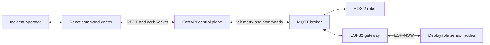
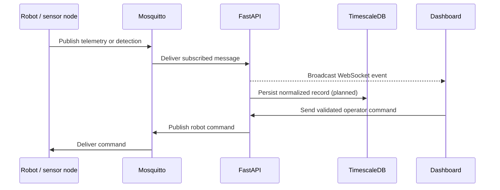
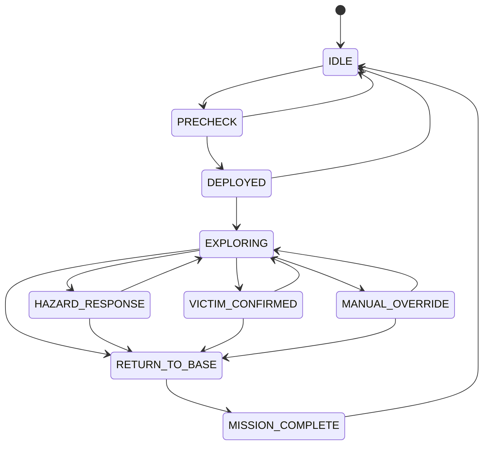
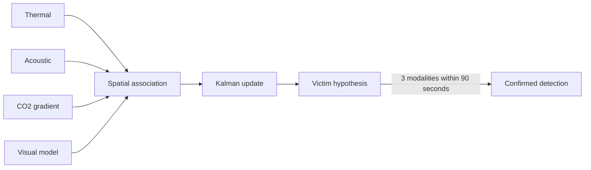

# DisasterMap system architecture

This document describes the intended platform boundaries, data flow, operating modes, and safety assumptions. The current repository is a simulation and integration prototype; components marked as planned still require physical hardware validation.

## System context

The command center is the operator-facing system of record. Robot-side safety controls must remain authoritative: loss of a browser, API, broker, or radio connection must never cause uncontrolled motion.

## Platform components

| Component | Responsibility | Current state |
|---|---|---|
| React dashboard | Mission visualization, controls, alerts, and playback | Functional simulation UI |
| Nginx | Static dashboard hosting and API/WebSocket reverse proxy | Configured |
| FastAPI | REST API, WebSocket hub, mission logic, and MQTT integration | Prototype |
| TimescaleDB/PostGIS | Relational, time-series, and spatial persistence | Models configured |
| Redis/Celery | Background jobs and result storage | Worker scaffolding |
| MinIO | Reports, rosbags, maps, and evidence artifacts | Infrastructure configured |
| Mosquitto | Robot, sensor, and command message transport | Development configuration |
| ROS 2 workspace | Mapping, navigation, perception, and hazards | Simulated prototype nodes |
| ESP32 firmware | Environmental sampling and ESP-NOW gateway | Prototype firmware |

## Runtime data flow

### Telemetry path

1. A robot or gateway publishes JSON or binary payloads to a namespaced MQTT topic.
2. The API MQTT consumer normalizes the envelope and forwards it to connected WebSocket clients.
3. Processing services associate detections, update map state, and evaluate hazard thresholds.
4. Persistent ingestion into TimescaleDB and artifact storage in MinIO are planned integration steps.

### Command path

1. The operator initiates a command in the dashboard.
2. FastAPI validates the request and publishes to the robot-specific MQTT command topic.
3. The robot bridge translates the command into ROS 2 messages or actions.
4. Robot-side watchdogs and safety controllers must reject stale, invalid, or unsafe commands.

## Mission state machine

The API rejects transitions outside the defined graph. Selected risk-increasing transitions require an explicit operator override. Physical deployment should add role-based authorization and an immutable audit trail.

## Survivor-detection pipeline

Confirmation thresholds are research defaults, not validated rescue criteria. Operators must be shown the underlying modalities and uncertainty rather than only a binary decision.

## Mapping and navigation

The intended mapping stack combines LiDAR/RGB-D SLAM, wheel odometry, IMU estimates, and optional UWB reference measurements. Frontier candidates are scored using expected information gain, travel cost, communication quality, hazard proximity, and battery state.

Navigation safety is layered:

- global and local Nav2 costmaps;
- hazard-derived no-go polygons;
- obstacle inflation and standoff distances;
- command timeouts and dead-man behavior;
- independent physical emergency stop;
- return-to-base behavior on battery or communication degradation.

Only the algorithmic and interface prototypes are present in this repository.

## Operating modes

| Mode | Data source | Intended use |
|---|---|---|
| Dashboard simulation | Browser-generated telemetry and seeded records | UI demonstrations and frontend development |
| API simulation | FastAPI-generated pose and sensor events when debug is enabled | WebSocket integration testing |
| Live integration | MQTT telemetry from ROS 2 and ESP32 devices | Future controlled hardware tests |

Simulation records must remain visibly distinguishable from field data. Production deployments should set `DEBUG=false` to disable the API simulation stream.

## Trust boundaries

- The browser is untrusted and must not directly control actuators.
- The API must authenticate users and authorize commands before publication.
- MQTT requires credentials, per-topic ACLs, and TLS outside a trusted lab network.
- Robot firmware and ROS 2 bridges must validate ranges, timestamps, and command freshness.
- Mission evidence can contain sensitive location and victim information and requires access control and retention rules.
- Object storage must not expose buckets anonymously.

The checked-in configuration is intended for local development and does not yet implement all of these controls.

## Deployment topology

Docker Compose starts the command-center services on one development host. The Nginx container serves the compiled dashboard at port `3000` and proxies API and WebSocket traffic to FastAPI. Robot and ESP32 devices connect to the host's LAN address for MQTT.

For a production topology, separate public ingress from the device network, terminate TLS, isolate data services, add health monitoring and backups, and provision secrets through a dedicated secret manager.
